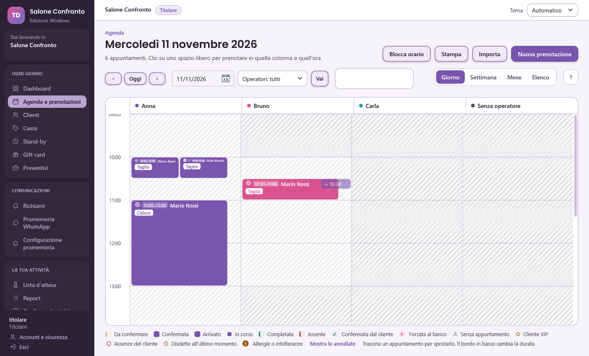
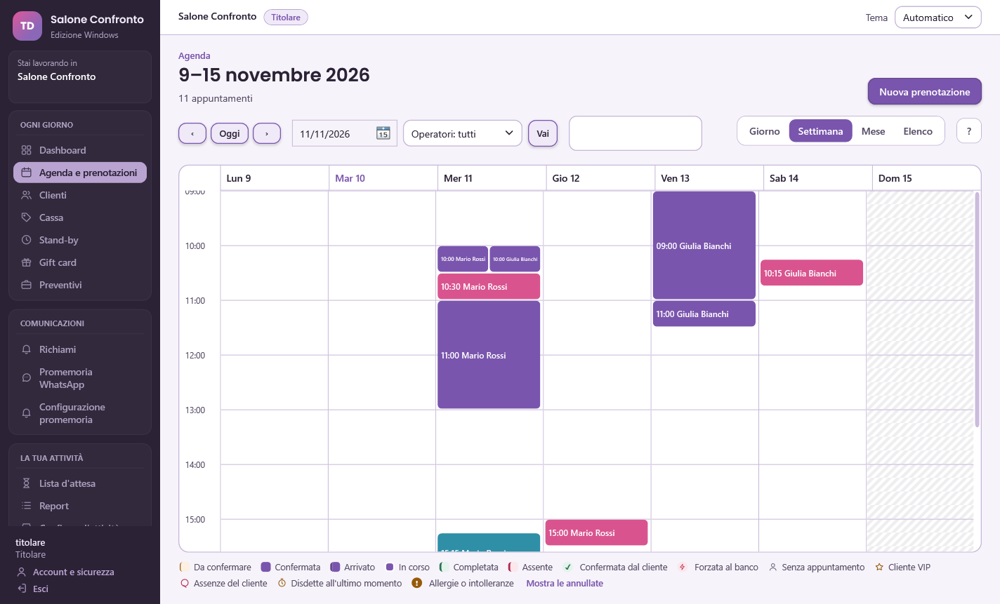
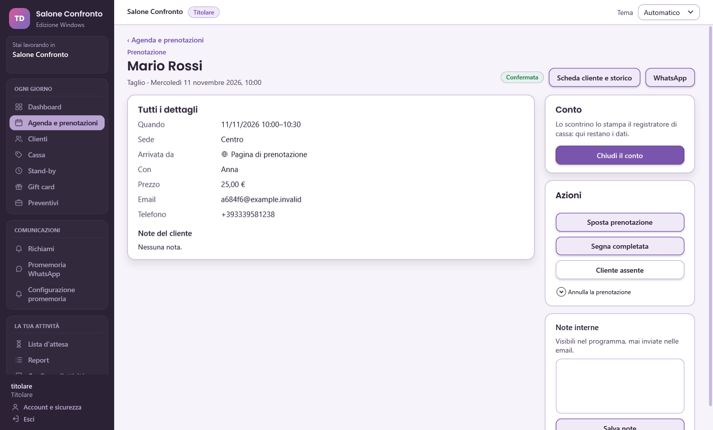
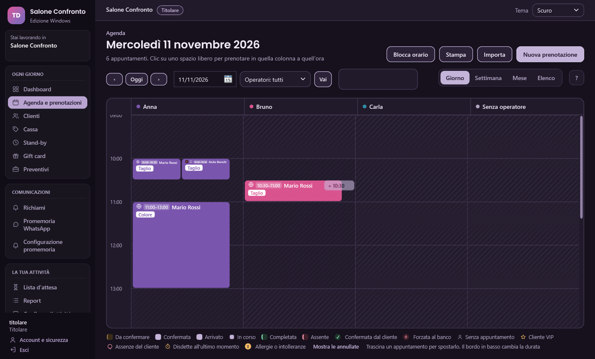

# TD Booking Suite per Windows

**Agenda, clienti e cassa in un programma per Windows, collegato al tuo sito. Si paga una volta: niente abbonamento e niente commissioni sulle prenotazioni.**

TD Booking Suite è nato per chi non vuole abbonarsi, o restare abbonato, alle piattaforme di prenotazione. Il programma sta sul PC dell'attività, con i suoi dati. Le prenotazioni online arrivano dal **tuo sito WordPress**, con il tuo nome, e non da un portale che mostra anche i concorrenti. Lo fa [Tastiere Digitali](https://tastieredigitali.tech).

**[Scarica l'ultima versione](../../releases/latest)**: un solo file MSI. I primi 7 giorni sono di prova gratuita, con tutte le funzioni.

| | |
|---|---|
|  |  |
| **Agenda del giorno**: una colonna per operatore; un clic su uno spazio libero e la prenotazione parte con operatore, giorno e ora | **Cassa**: scegli l'operatore, tocchi i servizi e mandi il conto al registratore telematico, che stampa lo scontrino |
|  |  |
| **Settimana**: i sette giorni ora per ora, un colore per operatore | **Mese**: quanti appuntamenti ha ogni giorno, un clic apre il giorno |
|  |  |
| **Nuova prenotazione**: servizio, operatore, giorno e ora liberi, il cliente cercato o nuovo | **La prenotazione**: tutti i dettagli, sposta, completa, annulla, le note interne e la scheda del cliente |
|  |  |
| **Clienti**: la rubrica con ricerca, etichette e VIP, le visite e l'ultima volta | **Scheda cliente**: recapiti, sconto, speso, appuntamenti in programma e lo storico dei trattamenti |
|  |  |
| **Elenco**: le prenotazioni per periodo, stato e nome | **Report**: incassi, servizi più fatti e operatori, in Excel e PDF |
|  |  |
| **Dashboard**: prenotazioni di oggi e dei prossimi giorni, le richieste arrivate dal sito e com'è andata l'ultima sincronizzazione | **Operatori**: la foto, i trattamenti che fanno con durata e prezzo loro, i giorni e orari, le ferie |
|  |  |
| **Configurazione guidata**: licenza, attività e backup, un passo alla volta | **Uno o due account**: lo usi tu con un account solo, oppure lo installi per un cliente con il suo |
|  |  |
| **Backup automatici**, cifrati, su disco esterno, NAS o server remoto | **Tema chiaro o scuro**, con il colore che preferisci |
|  |  |
| **Importa i clienti** dal programma di prima, da Excel o CSV | **Anteprima** prima di importare: cosa entra e cosa no |
|  |  |
| **Logo e aspetto**: il logo dell'attività in alto nel menu, il colore e la frase sotto il nome, con l'anteprima | **Email ai clienti**: conferma, modifica, annullamento e promemoria, con il tuo testo e l'anteprima |

## Collegato al tuo sito

Il programma non è un sito e non va messo su Internet: lavora sul PC. Il collegamento con i clienti passa dal **sito WordPress dell'attività**, con il plugin che si scarica dal programma.

- **Prenotazioni dal sito, anche a PC spento.** Il cliente sceglie servizio, operatore, giorno e orario nella pagina del tuo sito. Quando il PC è acceso, ogni 2 minuti il programma manda al sito servizi, operatori e orari liberi e prende le richieste arrivate. Non c'è nessuna porta da aprire nel router.
- **Le richieste diventano prenotazioni come le altre.** Se quell'orario nel frattempo l'hai dato al banco, la richiesta arriva tra quelle da confermare: la accetti, la sposti o la rifiuti, e il cliente riceve l'email.
- **Agenda riservata sul sito.** Titolare e collaboratori vedono le prenotazioni dal telefono, in una pagina del sito protetta da password, e aggiungono appuntamenti. Per spostare o annullare serve il programma.
- **Il sito come archivio.** Se lo accendi, il sito tiene una copia cifrata di prenotazioni, clienti, schede di lavoro, consensi e riepilogo degli scontrini: se il PC si rompe, si riprende tutto da lì.
- **Email anche con il PC spento.** Puoi lasciare al sito la conferma delle prenotazioni online e tutte le email ai clienti: conferma, promemoria, modifica e annullamento.

Si collega una volta sola, da **Impostazioni e sito**: scrivi l'indirizzo del sito, generi la chiave, installi il plugin e incolli la chiave. I passi sono nella guida dentro il programma.

## Cosa fa

- **Agenda del giorno, della settimana e del mese**: nel giorno una colonna per ogni operatore che lavora, nella settimana i sette giorni ora per ora, nel mese quanti appuntamenti ha ogni giorno. Ogni operatore ha il suo colore.
- **Appuntamenti alla stessa ora**: due appuntamenti che si accavallano sullo stesso operatore stanno affiancati nella sua colonna. Con il **+** accanto a un appuntamento ne aggiungi un altro alla stessa ora.
- **Agenda su misura**: trascini il bordo di una colonna per allargarla e la colonna delle ore per alzare le righe. Le misure restano salvate sul PC.
- **Cassa collegata al registratore telematico** (RCH ed Epson): scegli l'operatore, tocchi servizi e prodotti, incassi e lo scontrino esce dal registratore. Dalla cassa fai anche la chiusura giornaliera.
- **Operatori con foto, trattamenti, orari e ferie**: ognuno fa i servizi che spunti, ognuno con la sua durata e il suo prezzo se diversi, e, se serve, ha i suoi giorni di lavoro.
- **Clienti**: scheda con i recapiti sempre in vista, quanto ha speso, cosa ha in programma, lo storico dei trattamenti con i prezzi, dal più recente o dal più vecchio, le foto del lavoro, le note, le intolleranze e i consensi marketing.
- **Listino e sconti**: il titolare tiene servizi, varianti e prezzi; a un cliente dai uno sconto in percentuale o fisso, che vale da subito sulle sue prenotazioni.
- **Email ai clienti con promemoria**: conferma, modifica e annullamento, e il promemoria da 2 ore a 3 giorni prima, con i tuoi testi e l'anteprima. Il cliente sceglie se riceverle.
- **Importa dal programma di prima**: anagrafica e storico dei trattamenti da Excel o CSV. Per ogni colonna scegli cosa contiene e guardi l'anteprima prima di importare. Chi c'è già non viene sovrascritto né raddoppiato. I consensi marketing restano da confermare dal cliente.
- **Persone e permessi**: ognuno entra con il suo username e vede solo quello che il suo ruolo consente. Chi installa configura tipo di attività, sedi e persone con accesso; il titolare lavora e tiene aggiornati orari, operatori, listino e il suo logo.
- **Per diversi tipi di attività**: parrucchieri e centri estetici prima di tutto, e anche studi, ristoranti con i tavoli, strutture con le camere, corsi ed eventi.
- **Più PC nella stessa attività**: uno tiene i dati, gli altri PC della rete lo usano con lo stesso programma. Ogni PC si registra una volta, con un codice di 6 cifre.
- **Backup automatici ogni notte**, cifrati con la tua password, su disco esterno, NAS, FTP, FTPS o SFTP. Il ripristino si fa dal menu Start.
- **Il tuo marchio**: ogni attività mette il suo logo, che compare in alto nel menu, e sceglie colore e tema chiaro o scuro.

## Installare

### Firmato digitalmente

Il file d'installazione e il programma sono **firmati digitalmente** da Tastiere Digitali: prima di installare, Windows mostra il nostro nome come editore verificato.

### Scegli come usarlo

Durante l'installazione il programma chiede **Come userai TD Booking Suite su questo PC?**

| | |
|---|---|
| **Un PC solo** | Programma e dati su questo PC. Per un'attività con un solo computer: è la scelta di quasi tutti |
| **Server con postazioni** | Questo PC tiene i dati e resta acceso; gli altri PC dell'attività si collegano a lui dalla rete del negozio |
| **Solo postazione** | Solo la finestra del programma, per un PC che si collega al PC con i dati |

La scelta si cambia dopo, aprendo di nuovo l'installazione: i dati restano. In tutti i casi il collegamento con il sito funziona allo stesso modo.

Se lo reinstalli dopo averlo tolto, l'installer trova i dati di prima e chiede: **Usa i dati di prima**, e riparte da dove era, oppure **Ricomincia da zero**, con un programma vuoto e un nuovo primo avvio. I dati di prima non si cancellano: vanno da parte, interi, in `C:\ProgramData`. Licenza e prova restano.

### Il primo avvio e la configurazione guidata

1. Alla fine dell'installazione si apre TD Booking Suite con il **Primo avvio**. Il codice che chiede lo trovi nel menu Start, **TD Booking Suite**, **Codice del primo avvio** (serve il permesso di amministratore di Windows). Scegli lo **username** e la password dell'**amministratore del programma**; l'email è facoltativa.
2. La **configurazione guidata** ti porta passo per passo:
   - **Licenza**: attiva la **prova di 7 giorni**, oppure incolla la licenza;
   - **La tua attività e chi ci lavora**: nome e tipo dell'attività, poi **Io, con questo account** se il programma lo usi tu, oppure **Il titolare, con un suo account** se lo installi per qualcun altro;
   - **Backup**: password dei backup, backup automatico e una destinazione fuori dal PC.
3. **Al lavoro**: con un account solo vai direttamente all'agenda.

|  |  |
|---|---|
| **Primo avvio**: l'amministratore si crea solo dal PC del programma | **Licenza**: cosa consente e il codice installazione da mandarci |

### Sugli altri PC dell'attività

1. Installa lo stesso MSI scegliendo **Solo postazione**.
2. Al primo avvio scrivi l'indirizzo del PC con i dati, per esempio `https://ufficio-pc:8443`, e controlla che l'impronta del certificato sia la stessa della pagina Postazioni.
3. Sul PC con i dati, in **Postazioni**, genera il codice e scrivilo sull'altro PC.

## La licenza

**Si paga una volta sola.** Non c'è un canone mensile e non ci sono commissioni sulle prenotazioni. Dopo i 7 giorni di prova il programma chiede la licenza; prenotazioni e clienti restano salvati, e i backup continuano.

| | Attività | Altri PC in rete |
|---|---|---|
| **Un PC solo** | 1 | nessuno |
| **Server con postazioni** | 1 | quanti ti servono, oltre al PC con i dati |
| **Più attività** | 2 o più | quanti ti servono |

La licenza vale per il PC dove l'hai attivata. Per avere più postazioni o più attività ti mandiamo una licenza nuova: la incolli al posto della vecchia e non perdi niente.

### Come acquistare

Il prezzo è su richiesta. **Contattaci da [tastieredigitali.tech](https://tastieredigitali.tech)** e mandaci il **codice installazione** che trovi nella pagina Licenza del programma: ti mandiamo la licenza per il tuo PC. La incolli nella stessa pagina e il programma riparte subito, con tutti i dati.

## Requisiti

- Windows 10 o 11 a 64 bit, con 4 GB di RAM e qualche GB libero.
- Per le prenotazioni online: un sito WordPress dell'attività, dove installare il plugin.
- Per gli scontrini: un registratore telematico RCH o Epson collegato alla rete del negozio.

## Domande

**Dove sono i miei dati?** Sul PC con il programma, in `C:\ProgramData\TD Booking Suite`, e nei backup che scegli tu. Se accendi l'archivio, una copia cifrata sta anche sul tuo sito. Non passano da nostri server.

**Devo tenere il PC sempre acceso per ricevere le prenotazioni?** No. Il sito le prende anche a PC spento e il programma le scarica quando lo riaccendi.

**Devo aprire porte nel router o avere un indirizzo fisso?** No. È il programma che chiama il sito, non il contrario.

**Posso aggiornare senza perdere niente?** Sì: il programma avvisa quando c'è una versione nuova, oppure apri l'MSI nuovo sopra quello vecchio. Prima di aggiornare salva da solo una copia del database.

**Ho dimenticato la password.** Sul PC con il programma, menu Start, **TD Booking Suite**, **Recupera accesso**: vale per l'amministratore e per chiunque abbia un account. Serve un account amministratore di Windows.

**E se cambio PC?** Installa il programma sul PC nuovo e ripristina un backup dal menu Start. Poi chiedici la licenza con il nuovo codice installazione.

---

TD Booking Suite per Windows © Tastiere Digitali. Il programma si usa con una licenza di Tastiere Digitali, o nei 7 giorni di prova. I componenti di terze parti inclusi restano sotto le loro licenze, elencate nell'installer.
